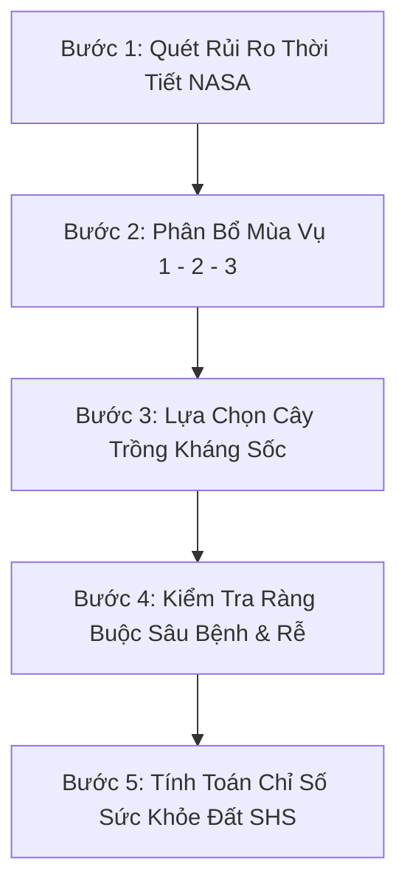

# Kỹ Năng Lập Kế Hoạch Luân Canh Thích Ứng (Crop Rotation Planner Skill)

Kỹ năng này hướng dẫn AI Agent cách phân tích dữ liệu khí hậu vệ tinh NASA, đối chiếu với đặc tính giống cây trồng trong cơ sở dữ liệu PostgreSQL để sinh ra một kế hoạch luân canh 3 vụ khoa học và tối ưu nhất cho người nông dân.

---

## 1. Đầu Vào Yêu Cầu (Inputs)
Khi thực hiện kỹ năng này, Agent cần có 3 nguồn thông tin:
1. **Dữ liệu phân tích NASA (`nasa_data`)**: Chứa nhiệt độ cực đại `T2M_MAX`, lượng mưa `PRECTOTCORR`, độ ẩm tầng rễ `GWETROOT`.
2. **Hồ sơ thổ nhưỡng (`SoilProfile`)**: Loại đất (Cát pha / Phù sa / Feralit), độ pH, hàm lượng mùn.
3. **Mục tiêu ưu tiên của nông dân (`farmer_goal`)**:
   - `soil_health`: Ưu tiên cải tạo đất và tích lũy đạm sinh học.
   - `water_saving`: Ưu tiên tiết kiệm nước tưới và chịu hạn.
   - `economic_balance`: Ưu tiên cân bằng sản lượng và an toàn kinh tế.

---

## 2. Quy Trình Phân Tích 5 Bước (5-Step Algorithm)

### Bước 1: Quét rủi ro thời tiết từ NASA
* Xác định tháng nóng nhất trong năm: Nếu $T_{max} \ge 38^\circ C$ $\rightarrow$ Bật cảnh báo **Nắng Nóng Cực Đoan (Gió Lào)** vào Vụ 2.
* Xác định tháng mưa nhiều nhất: Nếu Lượng mưa $\ge 11$ mm/ngày $\rightarrow$ Bật cảnh báo **Ngập Lụt & Mưa Bão** vào cuối Vụ 2 / đầu Vụ 3.

### Bước 2: Phân bổ khung thời gian 3 vụ
* **Vụ 1 (Đông Xuân - Tháng 1 đến Tháng 5)**: Mùa mưa nhẹ, nhiệt độ ôn hòa (22 - 28°C).
* **Vụ 2 (Hè Thu - Tháng 5 đến Tháng 8)**: Gió Lào khô hạn, nhiệt độ đỉnh điểm >40°C.
* **Vụ 3 (Thu Đông - Tháng 9 đến Tháng 12)**: Mưa bão đỉnh điểm tháng 9-10, sau đó chuyển lạnh.

### Bước 3: Lựa chọn giống cây trồng thích ứng
* **Vụ 1**: Ưu tiên cây ngũ cốc lương thực chủ lực (Lúa thuần chất lượng cao như Jasmine, ST24 hoặc Ngô xuân) để tận dụng nước đầu năm.
* **Vụ 2**: **Tuyệt đối không khuyến nghị lúa hè thu**. Bắt buộc chọn cây họ đậu hoặc cây có dầu chịu nhiệt cao (Lạc Sen Thọ / L14, Mè đen, Đậu xanh ngắn ngày) để:
  * Né hạn mùa gió Lào.
  * Cố định từ 45 - 60 kg N/ha nhờ nốt sần rễ.
  * Thu hoạch trước tháng 9 để tránh bão lũ.
* **Vụ 3**: Xuống giống sau ngày 15/10 (khi lũ rút), chọn cây lấy củ hoặc màu ưa lạnh (Khoai lang Hoàng Long, Ngô sinh khối) để che phủ chống xói mòn đất.

### Bước 4: Kiểm tra tính tương thích và cắt đứt sâu bệnh
* Đảm bảo không trồng 2 vụ liên tiếp cây cùng họ thực vật.
* Đảm bảo luân chuyển giữa rễ chùm ăn nông (Lúa) và rễ cọc phá nén dẽ (Lạc, Khoai).

### Bước 5: Tính toán chỉ số sức khỏe đất (Soil Health Score - SHS)
Công thức tính điểm sức khỏe đất:
$$\text{SHS} = \text{Base} + \Delta_{\text{Nitrogen}} + \Delta_{\text{Root}} - \text{Penalty}_{\text{Pest}} - \text{Penalty}_{\text{DroughtRisk}}$$
* **Nếu độc canh lúa 3 vụ**: Bị trừ điểm do mất đạm, đất nén dẽ và nguy cơ mất trắng vì gió Lào $\rightarrow$ Điểm số: **42 / 100 điểm**.
* **Nếu luân canh Lúa - Lạc - Khoai**: Được cộng điểm đạm sinh học (+25), tơi xốp rễ sâu (+15), né hạn né bão (+10) $\rightarrow$ Điểm số: **89 / 100 điểm**.
