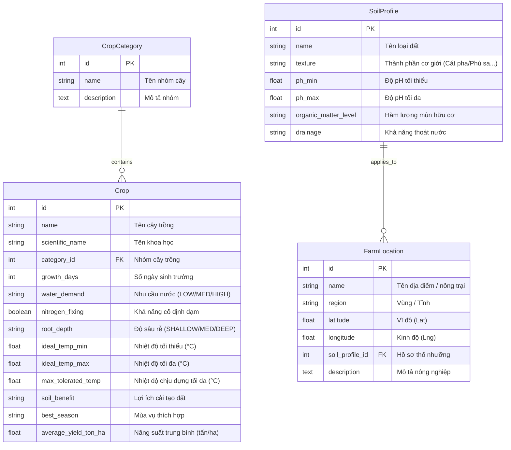

# Thiết Kế Cơ Sở Dữ Liệu PostgreSQL (Database Design)

Tài liệu này đặc tả toàn bộ cấu trúc cơ sở dữ liệu của dự án **FieldShift** trên hệ quản trị **PostgreSQL 18** thông qua Django ORM.

---

## 1. Sơ Đồ Thực Thể Quan Hệ (ERD)



---

## 2. Đặc Tả Chi Tiết Các Bảng (Tables Specification)

### 2.1 Bảng `farm_advisor_cropcategory`
Phân loại các nhóm cây trồng phục vụ thuật toán luân canh.

| Tên trường (Column) | Kiểu dữ liệu | Ràng buộc | Diễn giải |
| :--- | :--- | :--- | :--- |
| `id` | BIGSERIAL | PRIMARY KEY | Khóa chính tự tăng |
| `name` | VARCHAR(100) | NOT NULL | Tên nhóm (Ngũ cốc, Cây họ Đậu, Cây lấy củ, Cây có dầu...) |
| `description` | TEXT | NULL | Mô tả chi tiết vai trò của nhóm |

### 2.2 Bảng `farm_advisor_crop`
Hồ sơ sinh học và đặc tính nông học của từng giống cây trồng.

| Tên trường (Column) | Kiểu dữ liệu | Ràng buộc | Diễn giải |
| :--- | :--- | :--- | :--- |
| `id` | BIGSERIAL | PRIMARY KEY | Khóa chính tự tăng |
| `name` | VARCHAR(120) | NOT NULL | Tên cây (Lúa nước, Lạc Sen Thọ, Mè đen...) |
| `scientific_name` | VARCHAR(150) | NULL | Tên khoa học theo danh pháp thực vật |
| `category_id` | BIGINT | FOREIGN KEY | Liên kết tới `farm_advisor_cropcategory.id` |
| `growth_days` | INT | NOT NULL, DEFAULT 90 | Thời gian từ gieo hạt đến thu hoạch (ngày) |
| `water_demand` | VARCHAR(10) | NOT NULL | Mức tiêu thụ nước: `LOW`, `MED`, `HIGH` |
| `nitrogen_fixing` | BOOLEAN | NOT NULL, DEFAULT FALSE | `True` nếu rễ có nốt sần cố định đạm từ khí quyển |
| `root_depth` | VARCHAR(10) | NOT NULL | `SHALLOW` (<30cm), `MEDIUM` (30-60cm), `DEEP` (>60cm) |
| `ideal_temp_min` | DOUBLE PRECISION | NOT NULL, DEFAULT 20.0 | Ngưỡng nhiệt độ sinh trưởng dưới (°C) |
| `ideal_temp_max` | DOUBLE PRECISION | NOT NULL, DEFAULT 35.0 | Ngưỡng nhiệt độ sinh trưởng trên (°C) |
| `max_tolerated_temp` | DOUBLE PRECISION | NOT NULL, DEFAULT 40.0 | Nhiệt độ tối đa cây chịu được trước khi cháy lá |
| `soil_benefit` | VARCHAR(255) | NOT NULL | Lợi ích cho đất (tăng mùn, cố định N, phá nén dẽ) |
| `best_season` | VARCHAR(100) | NOT NULL | Mùa vụ gieo trồng tối ưu |
| `average_yield_ton_ha` | DOUBLE PRECISION | NOT NULL, DEFAULT 3.5 | Năng suất bình quân (tấn/ha) |

### 2.3 Bảng `farm_advisor_soilprofile`
Đặc tính lý - hóa của các nhóm thổ nhưỡng chính.

| Tên trường (Column) | Kiểu dữ liệu | Ràng buộc | Diễn giải |
| :--- | :--- | :--- | :--- |
| `id` | BIGSERIAL | PRIMARY KEY | Khóa chính tự tăng |
| `name` | VARCHAR(100) | NOT NULL | Tên nhóm đất (Đất cát pha Nghệ An, Đất phù sa...) |
| `texture` | VARCHAR(100) | NOT NULL | Thành phần cơ giới đất |
| `ph_min` | DOUBLE PRECISION | NOT NULL, DEFAULT 5.5 | Độ chua tối thiểu |
| `ph_max` | DOUBLE PRECISION | NOT NULL, DEFAULT 6.8 | Độ chua tối đa |
| `organic_matter_level` | VARCHAR(50) | NOT NULL | Hàm lượng mùn hữu cơ (Nghèo / Trung bình / Giàu) |
| `drainage` | VARCHAR(50) | NOT NULL | Tốc độ thoát nước (Nhanh / Trung bình / Kém) |

### 2.4 Bảng `farm_advisor_farmlocation`
Lưu trữ các điểm nông trại thí điểm hoặc trang trại người dùng đã đánh dấu.

| Tên trường (Column) | Kiểu dữ liệu | Ràng buộc | Diễn giải |
| :--- | :--- | :--- | :--- |
| `id` | BIGSERIAL | PRIMARY KEY | Khóa chính tự tăng |
| `name` | VARCHAR(150) | NOT NULL | Tên nông trại / địa phương |
| `region` | VARCHAR(100) | NOT NULL | Tỉnh / Vùng khí hậu (Nghệ An, Bến Tre...) |
| `latitude` | DOUBLE PRECISION | NOT NULL | Tọa độ Vĩ độ GPS |
| `longitude` | DOUBLE PRECISION | NOT NULL | Tọa độ Kinh độ GPS |
| `soil_profile_id` | BIGINT | FOREIGN KEY, NULLABLE | Liên kết tới `farm_advisor_soilprofile.id` |
| `description` | TEXT | NULL | Tóm tắt đặc trưng khí hậu và thổ nhưỡng |

---

## 3. Quy Tắc Quản Lý Migrations
- Tất cả các chỉnh sửa đối với models được quản lý hoàn toàn tự động qua Django Migrations:
  ```powershell
  python manage.py makemigrations farm_advisor
  python manage.py migrate
  ```
- Nạp dữ liệu giống cây và đất đai chuẩn thông qua lệnh:
  ```powershell
  python manage.py seed_data
  ```
