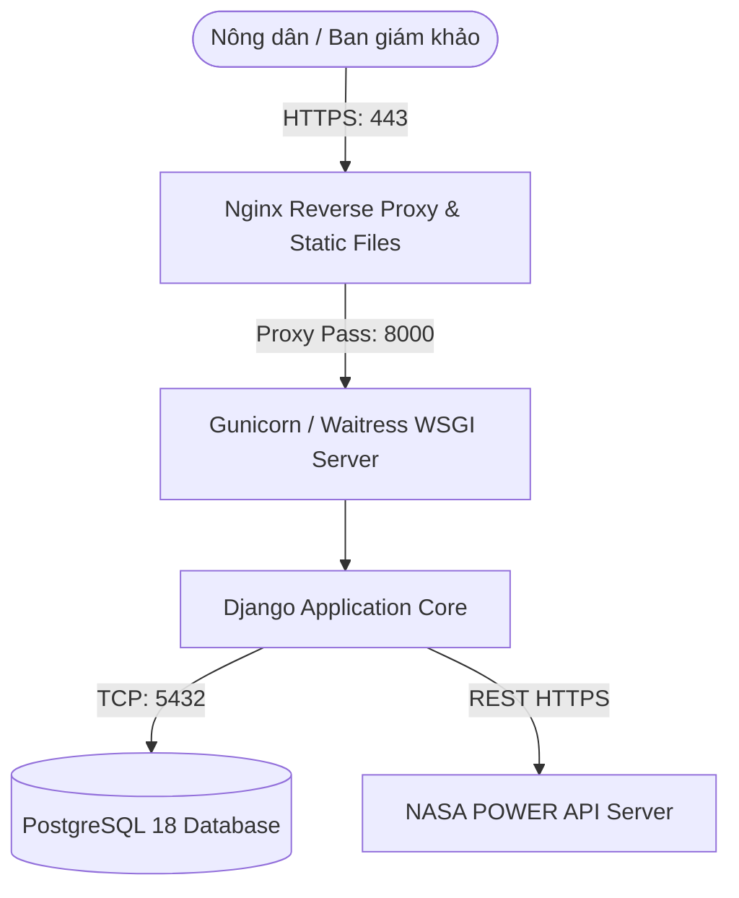

# Quy Trình Triển Khai & Vận Hành (Deployment & Operations Guide)

Tài liệu này đặc tả quy trình đưa hệ thống **FieldShift** lên môi trường chạy thực tế (Production), thiết lập biến môi trường và đóng gói hệ thống.

---

## 1. Kiến Trúc Môi Trường Vận Hành (Production Stack)



* **Web Server & Reverse Proxy**: **Nginx** tiếp nhận kết nối người dùng, quản lý chứng chỉ bảo mật SSL/TLS (Let's Encrypt) và phục vụ trực tiếp các tệp tĩnh (CSS, JS, Fonts).
* **WSGI Application Server**: **Gunicorn** (trên Linux) hoặc **Waitress** (trên Windows) điều phối các worker xử lý tiến trình Python Django.
* **Cơ sở dữ liệu**: **PostgreSQL 18** lưu trữ danh mục giống cây trồng, thổ nhưỡng và lịch sử phân tích.

---

## 2. Quản Lý Biến Môi Trường (Environment Variables)

Hệ thống sử dụng tệp `.env` để cấu hình các thông số bảo mật khi đưa lên máy chủ thật. **Tuyệt đối không commit tệp `.env` lên GitHub.**

| Tên biến (Key) | Bắt buộc | Ví dụ trên Môi trường Thật | Diễn giải |
| :--- | :---: | :--- | :--- |
| `SECRET_KEY` | Có | `django-insecure-prod-9a8b7c6d...` | Khóa bí mật ký mã phiên Django |
| `DEBUG` | Có | `False` | Tắt chế độ gỡ lỗi trên Production |
| `ALLOWED_HOSTS` | Có | `fieldshift.space,www.fieldshift.space` | Danh sách tên miền được phép truy cập |
| `DB_NAME` | Có | `fieldshift_db` | Tên cơ sở dữ liệu PostgreSQL |
| `DB_USER` | Có | `postgres` | Tên người dùng cơ sở dữ liệu |
| `DB_PASSWORD` | Có | `mật_khẩu_phức_tạp` | Mật khẩu truy cập PostgreSQL |
| `DB_HOST` | Có | `localhost` | Địa chỉ máy chủ database |
| `DB_PORT` | Có | `5432` | Cổng kết nối PostgreSQL |

---

## 3. Quy Trình Triển Khai Thủ Công Trên Máy Chủ (Step-by-Step)

```bash
# 1. Clone mã nguồn từ GitHub
git clone https://github.com/your-team/fieldshift.git
cd fieldshift

# 2. Khởi tạo môi trường ảo Python và cài đặt thư viện
python -m venv venv
source venv/bin/activate  # Trên Linux (hoặc .\venv\Scripts\Activate.ps1 trên Windows)
pip install -r requirements.txt

# 3. Gom tài nguyên tĩnh (Static Files)
python manage.py collectstatic --noinput

# 4. Chạy di chuyển cấu trúc cơ sở dữ liệu
python manage.py migrate

# 5. Nạp dữ liệu cây trồng và thổ nhưỡng mẫu ban đầu
python manage.py seed_data

# 6. Khởi chạy thông qua Gunicorn
gunicorn core.wsgi:application --bind 127.0.0.1:8000 --workers 3
```

---

## 4. Đóng Gói Triển Khai Bằng Docker (Docker Compose)

Hệ thống có thể đóng gói 1-click thông qua tệp `docker-compose.yml`:

```yaml
version: '3.8'

services:
  db:
    image: postgres:18-alpine
    environment:
      POSTGRES_DB: fieldshift_db
      POSTGRES_USER: postgres
      POSTGRES_PASSWORD: ${DB_PASSWORD:-170106}
    volumes:
      - postgres_data:/var/lib/postgresql/data
    ports:
      - "5432:5432"

  web:
    build: .
    command: gunicorn core.wsgi:application --bind 0.0.0.0:8000 --workers 3
    volumes:
      - .:/app
    ports:
      - "8000:8000"
    environment:
      - DEBUG=False
      - DB_HOST=db
      - DB_NAME=fieldshift_db
      - DB_USER=postgres
      - DB_PASSWORD=${DB_PASSWORD:-170106}
    depends_on:
      - db

volumes:
  postgres_data:
```
