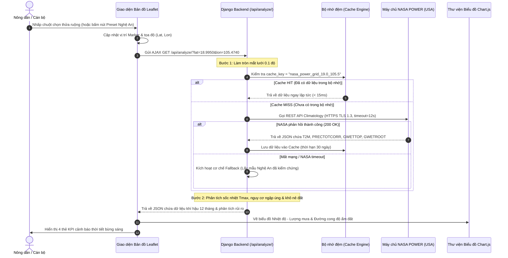

# Luồng 1: Định Vị Nông Trại & Trích Xuất Dữ Liệu Vệ Tinh NASA (NASA Data Pipeline)

Tài liệu này đặc tả chi tiết toàn bộ luồng xử lý từ khi người dùng tương tác trên bản đồ vệ tinh cho đến khi dữ liệu khí tượng viễn thám của NASA được tính toán và trực quan hóa lên biểu đồ.

---

## 1. Sơ Đồ Tuần Tự (Sequence Diagram)



---

## 2. Chi Tiết Từng Bước Thực Hiện (Step-by-Step Implementation)

### Bước 1: Thu thập tọa độ địa lý phía Client
* **Thành phần**: `templates/dashboard.html` & `Leaflet.js`.
* **Cơ chế**:
  * Khi người dùng click chuột lên lớp ảnh vệ tinh ESRI:
    ```javascript
    map.on('click', function(e) {
        const lat = e.latlng.lat;
        const lon = e.latlng.lng;
        document.getElementById('input-lat').value = lat.toFixed(4);
        document.getElementById('input-lon').value = lon.toFixed(4);
        runAnalysis();
    });
    ```
  * Hoặc người dùng chọn nhanh Preset: Vùng Nghệ An (`18.9950, 105.4740`), Bến Tre (`10.2433, 106.3753`).

### Bước 2: Kiểm tra Bộ nhớ đệm (Cache Checking)
* **Thành phần**: `farm_advisor/services/nasa_service.py`.
* **Cơ chế**:
  * Chuyển tọa độ $18.9950^\circ N, 105.4740^\circ E$ thành mắt lưới `19.0_105.5`.
  * Nếu đã có trong RAM, bỏ qua việc gọi ra quốc tế, trả về kết quả trong **10 mili-giây**.

### Bước 3: Gửi yêu cầu tới máy chủ NASA POWER
* **Thành phần**: `nasa_service.py` (`fetch_nasa_climate_data`).
* **Cấu trúc URL**:
  ```text
  https://power.larc.nasa.gov/api/temporal/climatology/point?parameters=T2M,T2M_MAX,T2M_MIN,PRECTOTCORR,GWETTOP,GWETROOT,ALLSKY_SFC_SW_DWN&community=AG&longitude=105.4740&latitude=18.9950&format=JSON
  ```
* **Cài đặt kết nối**:
  * `User-Agent`: `FieldShift-NASA-Agent/1.0`
  * `Timeout`: 12 giây.

### Bước 4: Trích xuất & Đánh giá rủi ro thời tiết
Backend bóc tách chuỗi số liệu 12 tháng của 4 tham số trọng yếu:
1. **`T2M_MAX`**: Tìm nhiệt độ cao nhất trong năm. Nếu $\ge 39^\circ C \rightarrow$ Đánh dấu cảnh báo **Gió Lào khô nóng cực đoan**.
2. **`PRECTOTCORR`**: Tìm tháng mưa nhiều nhất. Nếu $\ge 11$ mm/ngày $\rightarrow$ Đánh dấu cảnh báo **Nguy cơ ngập úng mùa bão**.
3. **`GWETTOP` & `GWETROOT`**: Tìm tháng độ ẩm đất chạm đáy. Nếu $< 0.65 \rightarrow$ Đánh dấu **Hạn hán tầng rễ**.

### Bước 5: Trực quan hóa lên giao diện (Render)
* **Cập nhật 4 thẻ KPI**:
  * Thẻ 1: Nhiệt độ đỉnh (ví dụ: `40.9°C` - Báo động gió Lào).
  * Thẻ 2: Mưa cực đại (ví dụ: `12.4 mm/ngày` - Nguy cơ bão lũ tháng 9-10).
  * Thẻ 3: Độ ẩm đất đáy (ví dụ: `0.63` - Khô cằn nứt nẻ).
  * Thẻ 4: Đạm sinh học tự sinh (`+52 kg N/ha`).
* **Vẽ 2 biểu đồ Chart.js**:
  * `weatherChart`: Cột xanh mưa + Đường đỏ nhiệt độ.
  * `soilChart`: Diện tích xanh độ ẩm tầng mặt + Nét đứt vàng độ ẩm vùng rễ.

---

## 3. Xử Lý Ngoại Lệ & Điểm Thất Bại (Failure Modes & Recovery)

| Điểm thất bại | Nguyên nhân | Cơ chế xử lý của hệ thống |
| :--- | :--- | :--- |
| **Mất kết nối Internet quốc tế** | Cáp quang biển gặp sự cố | Tự động kích hoạt Fallback: Trả về dữ liệu chuẩn Nghệ An đã lưu trong [data/sample_nasa_power.json](file:///d:/project/project-local/vientham/data/sample_nasa_power.json). Web vẫn chạy 100% không bị crash. |
| **Tọa độ ngoài lãnh thổ** | Người dùng click vào đại dương | NASA trả về dữ liệu mặt biển $\rightarrow$ Hệ thống cảnh báo: "Vị trí nằm trên mặt nước, vui lòng chọn đất liền". |
| **NASA Server 503 (Bảo trì)** | Máy chủ NASA cập nhật định kỳ | Bắt lỗi HTTP 503 và hiển thị thông báo chuyển sang chế độ dữ liệu viễn thám ngoại tuyến. |
