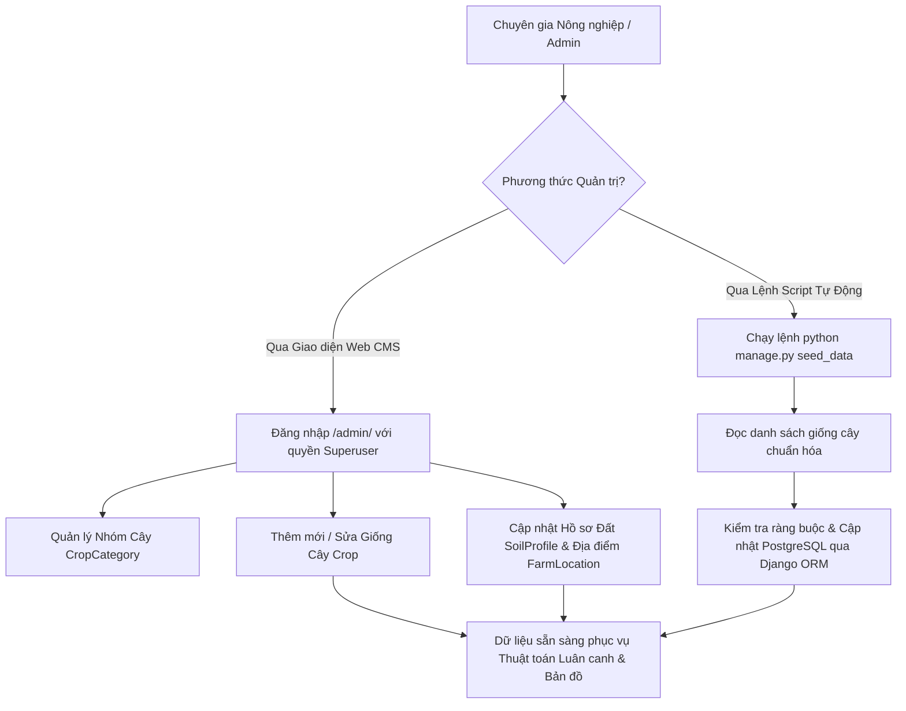

# Luồng 3: Quản Trị Dữ Liệu Nông Nghiệp & Cây Trồng (Agro Data Management Flow)

Tài liệu này đặc tả chi tiết quy trình dành cho **Cán bộ khuyến nông, Chuyên gia nông nghiệp và Quản trị viên** trong việc cập nhật hồ sơ thổ nhưỡng và nạp các giống cây trồng mới vào cơ sở dữ liệu **PostgreSQL 18**.

---

## 1. Sơ Đồ Quy Trình Quản Trị Dữ Liệu (Admin Management Flow)



---

## 2. Quản Trị Qua Giao Diện Web Django Admin (`/admin/`)

### Bước 1: Đăng nhập cổng quản trị
* **Địa chỉ truy cập**: `http://127.0.0.1:8000/admin/`
* **Tài khoản mặc định**:
  * Tên đăng nhập: `admin`
  * Mật khẩu: `170106` (được bảo vệ bằng mã hóa PBKDF2/SHA-256).

### Bước 2: Quản lý Danh mục Giống Cây Trồng (`Crop`)
Khi thêm mới một giống cây, chuyên gia nông nghiệp cần hoàn thiện các trường dữ liệu bắt buộc:
1. **Thông tin chung**:
   * `name`: Tên phổ thông kèm ký hiệu giống (ví dụ: *Lạc Sen Thọ L14*, *Đậu tương DT84*).
   * `scientific_name`: Tên khoa học theo chuẩn thực vật (*Arachis hypogaea*).
   * `category`: Chọn nhóm (*Cây họ Đậu*, *Ngũ cốc*, *Cây lấy củ*...).
2. **Đặc tính nông học**:
   * `growth_days`: Số ngày từ gieo hạt đến thu hoạch (ví dụ: 85 ngày).
   * `water_demand`: Nhu cầu nước (`LOW`: chịu hạn, `MED`: vừa, `HIGH`: ngập nước).
   * `nitrogen_fixing`: Tích chọn nếu có nốt sần rễ cố định đạm.
   * `root_depth`: Tầng rễ (`SHALLOW`: nông, `MEDIUM`: vừa, `DEEP`: rễ cọc sâu).
3. **Ngưỡng nhiệt độ sinh học**:
   * `ideal_temp_min` & `ideal_temp_max`: Khoảng nhiệt độ sinh trưởng tối ưu (ví dụ: 25.0 – 38.0°C).
   * `max_tolerated_temp`: Ngưỡng nhiệt chịu đựng tối đa trước khi cháy lá (ví dụ: 42.0°C).
4. **Lợi ích đất & Năng suất**:
   * `soil_benefit`: Lợi ích cụ thể (ví dụ: *"Tự nạp 50kg N/ha, tăng mùn, phá nén dẽ"*).
   * `average_yield_ton_ha`: Năng suất dự kiến (tấn/ha).

---

## 3. Quản Trị Tự Động Qua Lệnh CLI (`seed_data`)

Khi triển khai hệ thống mới hoặc nạp dữ liệu mẫu ban đầu, thực hiện bằng dòng lệnh duy nhất:

```powershell
# Kích hoạt môi trường ảo
.\venv\Scripts\Activate.ps1

# Chạy lệnh nạp toàn bộ danh mục cây trồng & thổ nhưỡng Nghệ An, ĐBSCL
python manage.py seed_data
```

### Cơ chế hoạt động của lệnh `seed_data`:
* Tệp triển khai: [farm_advisor/management/commands/seed_data.py](file:///d:/project/project-local/vientham/farm_advisor/management/commands/seed_data.py).
* Sử dụng phương thức `update_or_create` của Django ORM để đảm bảo:
  * Nếu giống cây chưa có $\rightarrow$ Tự động tạo mới.
  * Nếu giống cây đã có $\rightarrow$ Cập nhật thông số mới nhất mà không làm trùng lặp dữ liệu (Idempotency).

---

## 4. Kiểm Tra Toàn Vẹn Dữ Liệu Trong PostgreSQL

Bạn có thể kiểm tra trực tiếp số lượng bản ghi trong cơ sở dữ liệu `fieldshift_db` bằng PowerShell:

```powershell
$env:PGPASSWORD='170106'
& "D:\PostgreSQL\bin\psql.exe" -U postgres -d fieldshift_db -c "SELECT id, name, water_demand, nitrogen_fixing, average_yield_ton_ha FROM farm_advisor_crop;"
```
