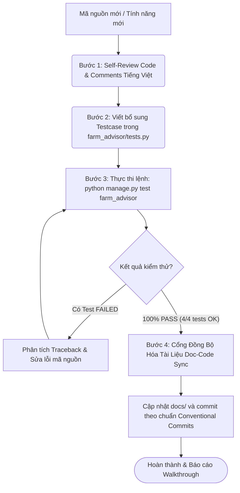

# Luồng 5: Kiểm Thử Tự Động & Đảm Bảo Chất Lượng Mã Nguồn (Automated Testing & QA Flow)

Tài liệu này đặc tả quy trình kiểm thử tự động, kiểm soát lỗi và nghiệm thu chất lượng mã nguồn trong dự án **FieldShift** trước khi bàn giao hoặc đẩy code lên kho lưu trữ.

---

## 1. Sơ Đồ Quy Trình Kiểm Thử (Testing & QA Pipeline)



---

## 2. Cấu Trúc Bộ Kiểm Thử (Test Suite Breakdown)

Toàn bộ testcase được viết trong tệp [farm_advisor/tests.py](file:///d:/project/project-local/vientham/farm_advisor/tests.py) chia thành 3 nhóm:

### 2.1 Kiểm thử Mô hình Dữ liệu (`CropModelTestCase`)
* **Mục tiêu**: Đảm bảo các thuộc tính sinh học của giống cây trồng lưu vào PostgreSQL hoạt động chính xác.
* **Kịch bản kiểm tra**:
  * Tạo giống cây *Lạc Sen Thọ* thuộc nhóm *Cây họ Đậu*.
  * Kiểm tra cờ cố định đạm `crop.nitrogen_fixing == True`.
  * Kiểm tra nhu cầu nước `crop.water_demand == 'LOW'`.
  * Kiểm tra chuỗi định danh `__str__` trả về đúng tên giống.

### 2.2 Kiểm thử Động cơ Luân canh (`RotationEngineTestCase`)
* **Mục tiêu**: Kiểm tra tính đúng đắn của thuật toán ứng phó thời tiết cực đoan.
* **Kịch bản kiểm tra**:
  * Giả lập dữ liệu sốc nhiệt: $T_{max} = 41.2^\circ C$ và lượng mưa bão lũ $= 13.5$ mm/ngày.
  * Xác nhận kết quả trả về đủ 3 vụ gieo trồng:
    * Vụ 1 chứa từ khóa *"Lúa"*.
    * Vụ 2 **bắt buộc chứa từ khóa "Lạc"** và loại cây là *"Cây họ Đậu cố định đạm (Legume)"*.
    * Vụ 3 chứa từ khóa *"Khoai"*.
  * Xác nhận điểm số sức khỏe đất: Độc canh đạt 42 điểm, Luân canh đạt 89 điểm.

### 2.3 Kiểm thử Tích hợp API & Giao diện (`ApiEndpointTestCase`)
* **Mục tiêu**: Kiểm tra tính sẵn sàng của các cổng giao tiếp mạng.
* **Kịch bản kiểm tra**:
  * Gửi HTTP GET tới `/` $\rightarrow$ Mã trạng thái HTTP phải là `200 OK`.
  * Gửi HTTP GET tới `/api/analyze/?lat=18.9950&lon=105.4740&goal=soil_health` $\rightarrow$ Trả về mã `200 OK`, JSON có trường `success: true`, chứa đầy đủ nhánh `nasa` và `plan`.

---

## 3. Lệnh Thực Thi & Đọc Kết Quả Kiểm Thử

### Lệnh chạy kiểm thử:
```powershell
# Kích hoạt môi trường ảo
.\venv\Scripts\Activate.ps1

# Chạy kiểm thử chi tiết kèm thời gian
python manage.py test farm_advisor -v 2
```

### Kết quả chuẩn khi đạt 100% PASS:
```text
Creating test database for alias 'default'...
test_crop_creation (farm_advisor.tests.CropModelTestCase) ... ok
test_rotation_plan_schedule (farm_advisor.tests.RotationEngineTestCase) ... ok
test_dashboard_status_code (farm_advisor.tests.ApiEndpointTestCase) ... ok
test_api_analyze_farm_status (farm_advisor.tests.ApiEndpointTestCase) ... ok

----------------------------------------------------------------------
Ran 4 tests in 1.250s

OK
Destroying test database for alias 'default'...
```

---

## 4. Kỷ Luật Kỹ Thuật (Testing Rules)
1. **Tuyệt đối không bỏ qua kiểm thử**: Không được commit mã nguồn nếu chưa chạy pass 100% test suite.
2. **Database Test Độc Lập**: Django tự động tạo database ảo tạm thời (`test_fieldshift_db`) và tự hủy sau khi test xong, không bao giờ ghi đè làm bẩn dữ liệu thật.
