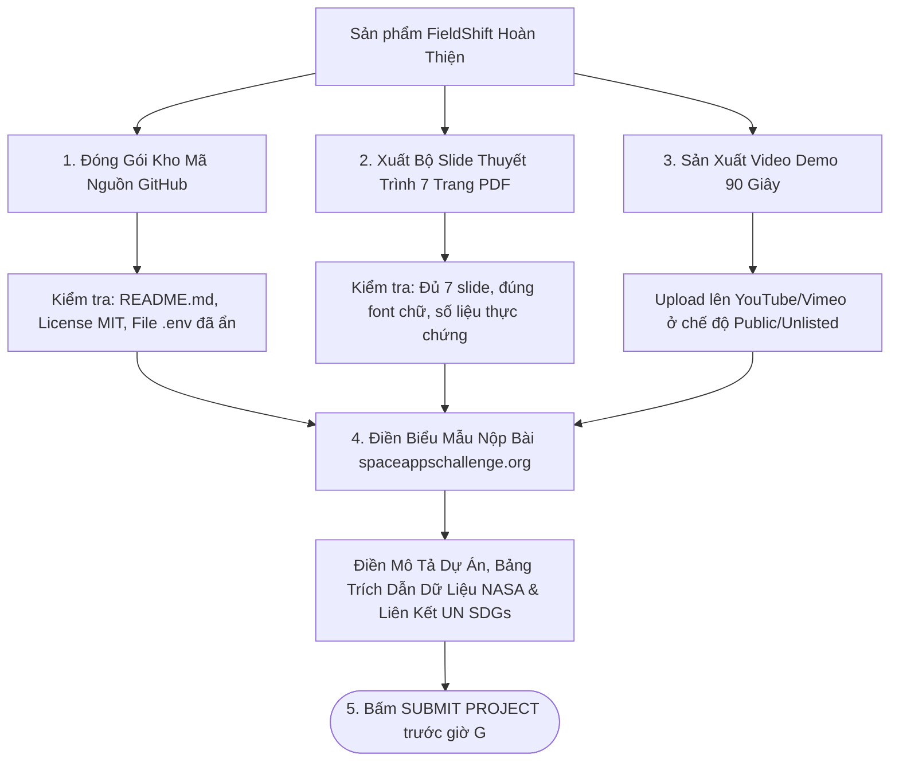

# Luồng 6: Chuẩn Bị & Đóng Gói Hồ Sơ Nộp Bài NASA Space Apps (NASA Submission Flow)

Tài liệu này đặc tả toàn bộ quy trình chuẩn bị, đóng gói và hoàn tất thủ tục nộp bài dự thi trên cổng thông tin chính thức của **NASA Space Apps Challenge** (`spaceappschallenge.org`).

---

## 1. Sơ Đồ Quy Trình Nộp Bài (Submission Pipeline)



---

## 2. Chi Tiết Từng Hạng Mục Cần Chuẩn Bị

### Hạng mục 1: Kho mã nguồn GitHub (GitHub Repository)
* **Yêu cầu của NASA**: Mã nguồn phải mở (Open Source) và có hướng dẫn cài đặt rõ ràng.
* **Các tệp bắt buộc tại thư mục gốc**:
  * [README.md](file:///d:/project/project-local/vientham/README.md): Hiển thị hình ảnh giao diện, sơ đồ kiến trúc, link video demo và lệnh chạy.
  * `LICENSE`: Giấy phép mã nguồn mở MIT.
  * [requirements.txt](file:///d:/project/project-local/vientham/requirements.txt): Liệt kê thư viện `django`, `requests`, `psycopg[binary]`.
  * [.gitignore](file:///d:/project/project-local/vientham/.gitignore): Đã loại trừ tệp `.env` chứa mật khẩu database.

### Hạng mục 2: Bộ Slide thuyết trình (7-Slide Pitch Deck)
* **Định dạng**: File PDF tải lên Google Drive / Canva và lấy link công khai.
* **Cấu trúc 7 trang chuẩn**:
  1. Slide 1: Bìa dự án (**FieldShift** - Thích ứng nông trại với dữ liệu NASA).
  2. Slide 2: Vấn đề (Khủng hoảng kép nắng nóng gió Lào & bão lũ, đất thoái hóa).
  3. Slide 3: Giải pháp (Hệ thống hỗ trợ ra quyết định DSS).
  4. Slide 4: Dữ liệu NASA sử dụng (`T2M_MAX`, `PRECTOTCORR`, `GWETTOP`, `GWETROOT`).
  5. Slide 5: Trình diễn giao diện Dashboard bản đồ vệ tinh & 2 biểu đồ Chart.js.
  6. Slide 6: Tác động xã hội (Giảm 50.3% nước, nạp +52kg N/ha, đóng góp UN SDG 2, 13, 15).
  7. Slide 7: Lộ trình phát triển & Giới thiệu thành viên nhóm.

### Hạng mục 3: Video Demo 90 giây (Demo Video)
* **Thời lượng tối đa**: 2 phút (Khuyên dùng từ 60 – 90 giây).
* **Nền tảng đăng tải**: YouTube hoặc Vimeo.
* **Nội dung video**:
  * 15 giây đầu: Cảnh báo thời tiết khắc nghiệt tại Nghệ An / Việt Nam.
  * 30 giây tiếp: Thao tác thực tế trên web: click chọn vị trí $\rightarrow$ biểu đồ NASA bừng sáng.
  * 30 giây tiếp: Đột phá luân canh: thay lúa bằng lạc né hạn, phục hồi đạm tự nhiên.
  * 15 giây cuối: Đo lường tác động (Điểm đất 89/100) và lời kêu gọi hành động vì Trái Đất.

---

## 3. Bản Mẫu Điền Thông Tin Trên Cổng Nộp Bài NASA

Khi mở form nộp bài trên trang `spaceappschallenge.org`, copy các đoạn nội dung chuẩn sau:

### 1. Project Title (Tên Dự Án):
```text
FieldShift: Adapting Farms with NASA Earth Observations for Resilient Soils
```

### 2. High-Level Summary (Tóm Tắt 1 Đoạn):
```text
Farmers worldwide face unprecedented climate shocks: extreme heatwaves, erratic rainfall, and rapid soil degradation caused by continuous monoculture. FieldShift is an AI-powered Decision Support System that translates NASA Earth Observations (NASA POWER & MERRA-2) into actionable 3-season crop rotation strategies. By dynamically replacing water-intensive summer rice with drought-resilient, nitrogen-fixing legumes during extreme heatwaves, FieldShift saves over 50% of irrigation water, naturally injects +52 kg of bio-nitrogen per hectare back into the soil, and raises the Soil Health Score from 42 to 89 points.
```

### 3. Space Agency Data Used (Dữ Liệu Không Gian Đã Dùng):
```text
- NASA POWER Agroclimatology API (Daily & Climatology temporal levels)
- MERRA-2 Atmospheric Reanalysis (T2M_MAX, T2M, PRECTOTCORR)
- NASA Land Data Assimilation Systems (Surface Soil Wetness GWETTOP & Root Zone Soil Wetness GWETROOT)
- All-Sky Surface Shortwave Downward Irradiance (ALLSKY_SFC_SW_DWN)
```

---

## 4. Bảng Kiểm Tra Trước Giờ Nộp Bài (Pre-Submission Checklist)

- [ ] Đường link GitHub repository để ở chế độ **Public**.
- [ ] File `.env` không bị lộ trên GitHub commit history.
- [ ] Video demo trên YouTube đã mở chế độ **Public** hoặc **Unlisted** (không để Private).
- [ ] Link Slide thuyết trình PDF đã bật quyền *"Bất kỳ ai có liên kết đều có thể xem"*.
- [ ] Đã bấm nút **Submit Project** trước hạn chót (Deadline) ít nhất 2 giờ để tránh nghẽn mạng!
