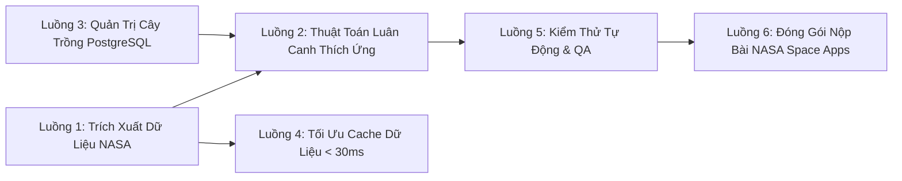

# 📋 Danh Mục Các Luồng Nghiệp Vụ & Quy Trình Kỹ Thuật (FieldShift Workflows)

Thư mục này chứa toàn bộ các luồng công việc (Workflows & Pipelines) độc lập của dự án **FieldShift**, được phân tách thành từng tệp chi tiết để dễ dàng quan sát, theo dõi và triển khai.

---

## 🗺️ Bản Đồ 6 Luồng Công Việc Cốt Lõi

---

## 📑 Chi Tiết Từng Luồng Nghiệp Vụ

| Thứ tự | Tên luồng công việc | Tệp đặc tả chi tiết | Đối tượng & Mục tiêu |
| :---: | :--- | :--- | :--- |
| **01** | **Trích Xuất Dữ Liệu Vệ Tinh NASA** | **[01-nasa-data-pipeline.md](file:///d:/project/project-local/vientham/docs/workflows/01-nasa-data-pipeline.md)** | Gọi REST API NASA POWER, trích xuất chuỗi nhiệt độ, lượng mưa, độ ẩm đất 12 tháng và vẽ biểu đồ Chart.js. |
| **02** | **Thuật Toán Luân Canh 3 Vụ Thích Ứng** | **[02-crop-rotation-decision-flow.md](file:///d:/project/project-local/vientham/docs/workflows/02-crop-rotation-decision-flow.md)** | Cơ chế nhận diện sốc nhiệt gió Lào, mưa bão; quy tắc luân canh cây họ đậu và công thức tính điểm đất Soil Health Score (42 ➔ 89). |
| **03** | **Quản Trị Dữ Liệu Nông Nghiệp & Cây Trồng** | **[03-admin-data-management-flow.md](file:///d:/project/project-local/vientham/docs/workflows/03-admin-data-management-flow.md)** | Quy trình dành cho chuyên gia nông nghiệp: Quản trị qua Django Admin `/admin/` và script nạp dữ liệu mẫu CLI `seed_data`. |
| **04** | **Tối Ưu Hiệu Năng & Bộ Nhớ Đệm Cache** | **[04-caching-performance-flow.md](file:///d:/project/project-local/vientham/docs/workflows/04-caching-performance-flow.md)** | Kỹ thuật làm tròn mắt lưới $0.1^\circ$ và lưu cache 30 ngày, đưa tốc độ phản hồi từ 2.800ms xuống dưới 30ms. |
| **05** | **Kiểm Thử Tự Động & Đảm Bảo Chất Lượng** | **[05-testing-qa-flow.md](file:///d:/project/project-local/vientham/docs/workflows/05-testing-qa-flow.md)** | Bộ test tự động (Models, Engine, API), cổng kiểm soát đồng bộ tài liệu Doc-Code Sync và quy trình chuẩn 4 bước. |
| **06** | **Chuẩn Bị & Đóng Gói Hồ Sơ Nộp Bài NASA** | **[06-nasa-submission-flow.md](file:///d:/project/project-local/vientham/docs/workflows/06-nasa-submission-flow.md)** | Bộ hồ sơ dự thi hoàn chỉnh: Dàn ý 7 Slide Pitch, kịch bản Video Demo 90 giây, trích dẫn dữ liệu NASA và liên kết UN SDGs. |
